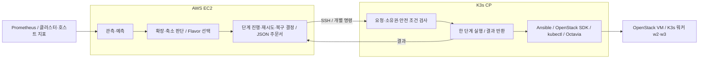

# BEET — OpenStack·K3s 예측 기반 워커 자동 확장

**2차 팀 프로젝트 · 김준백 담당 코드**

[](https://github.com/Kimjunbaek/beet-openstack-autoscaling/actions/workflows/ci.yml)

클러스터의 CPU·메모리 수요를 예측하고 필요한 시점에 OpenStack VM을 생성해 K3s 워커로 등록하는 자동화입니다. 새 워커를 검증한 뒤 Octavia 풀에 연결하고, 안정화되면 역순으로 회수하도록 구성했습니다.

**최종 역할 분리: EC2가 판단·Flavor 선택·명령 순서를 결정하고, CP는 받은 개별 명령을 실행·검증해 결과만 반환합니다.**

## 담당 범위와 협업 경계

| 구분 | 범위 |
|---|---|
| 담당 작업 | K3s 워커 연결·등록과 검증, Ansible VM 생성 및 Octavia 연동, SSH 명령 경계, EC2/CP 역할 분리, 동적 Flavor 및 w2/w3 확장·회수 정책 연동, 테스트·디버깅 |
| 팀 코드와 통합한 부분 | 기존 Prometheus·분석기·Discord 알림 흐름에 워커 관리 기능을 추가/수정 |
| 별도 팀 기능·계획 | Nextcloud 서비스, 팀 모니터링 환경, KEDA/HPA 파드 확장, AWS 확장·Terraform 통합 |

KEDA/HPA의 파드 확장이 실제로 먼저 발생했다는 전체 부하 시험 결과는 이 공개본에서 확인할 수 없습니다. 노드 확장 정책·실행 경로와 파드 확장은 구분합니다. EC2 분석기 전체를 혼자 처음부터 작성했다는 의미도 아닙니다.

## 구조



CP의 `capacity-controller.py`는 이전 파일명을 유지한 실행 보조 라이브러리입니다. CP가 별도로 예측하거나 다음 단계를 결정하지 않습니다. 이전 `beet-capacity.timer`를 함께 실행하지 않습니다.

## 알고리즘

1. EC2가 클러스터 CPU·RAM 요청량, 노드 상태, 물리 호스트 자원과 Nova 할당량을 수집합니다. 누락되거나 오래된 관측은 생성 판단에 그대로 사용하지 않습니다.
2. 미래 부족 CPU·RAM과 단일 파드 수용 조건을 비교해 허용 목록의 적합한 작은 Flavor를 선택합니다. OpenStack의 Flavor 이름은 해당 환경에서 정의한 값입니다. `t3.medium`이라는 이름만으로 AWS EC2 사양과 동일하다고 가정하지 않습니다.
3. 물리 CPU 사용률·여유 코어·MemAvailable·디스크와 프로젝트 할당량을 함께 확인합니다. 단일 물리 호스트 기준이며 Nova 최종 배치 성공을 보장하지 않습니다.
4. 기존 `w1`은 유지하고 `w2 → w3` 순서로 확장을 결정합니다. 각 단계의 성공 결과를 받은 후 다음 명령을 보냅니다.
5. CPU·RAM 저부하가 15분 유지되고 회수 후 남은 노드에도 수요가 들어갈 때 `w3 → w2` 순서로 회수합니다. 완료 후 10분 쿨다운을 적용합니다.
6. 삭제 전 단계가 실패하면 EC2가 uncordon·LB 재활성화 등의 복구 명령을 결정합니다. 파드가 남아 있다는 이유로 강제 VM 삭제를 강행하지 않습니다.

확장 순서:

`observe → reserve_port → create_vm → join → verify → lb_add → health → complete`

회수 순서:

`observe → lb_disable → cordon → drain → verify_relocated → lb_remove → delete_vm → delete_node → delete_port → health → complete`

## 파일 안내

| 위치 | 역할 |
|---|---|
| [ec2/analyzer/prom.py](ec2/analyzer/prom.py) | 관측 수집·신선도 확인 |
| [ec2/analyzer/forecast.py](ec2/analyzer/forecast.py), [saturation.py](ec2/analyzer/saturation.py) | 요청량·추세와 임계점 도달 시점 추정 |
| [ec2/analyzer/decide.py](ec2/analyzer/decide.py) | 확장/회수 대상과 Flavor 결정, 물리 자원 조건 |
| [ec2/analyzer/executor.py](ec2/analyzer/executor.py) | EC2 측 단계 상태 머신·JSON 주문·SSH 호출·작업 상태 보존 |
| [ec2/analyzer/actions.py](ec2/analyzer/actions.py), [config.py](ec2/analyzer/config.py) | 판단 결과 연결, 실행 모드·스위치 |
| [cp/worker-exec.py](cp/worker-exec.py) | 한 명령만 실행하는 CP 경계, 중복·오래된 명령·자원 변경 검사 |
| [cp/capacity-controller.py](cp/capacity-controller.py) | 자원 관측·요청량 해석·생성 안전 조건 및 실행 보조 |
| [cp/provision.yml](cp/provision.yml) | EC2가 지정한 태그에 한해 VM 생성·조인·검증·LB 반영 |
| [cp/verify.yml](cp/verify.yml) | agent 상태·Ready·테스트 파드 DNS 확인 및 임시 파드 제거 |
| [cp/analyzer-ssh-command.sh](cp/analyzer-ssh-command.sh) | 제한 SSH 요청 수신과 중복 실행 방지 |
| [cp/console-host-key.py](cp/console-host-key.py) | Nova 콘솔의 신규 VM SSH 공개 호스트 키 확인 |
| [cp/octavia-member.py](cp/octavia-member.py) | 풀 멤버 연결·상태와 VIP 응답 확인 |
| [cp/capacity-config.json](cp/capacity-config.json) | 예시 환경·물리 자원 여유·허용 사양 목록 |

## 검증 결과

| 구분 | 확인된 사실 |
|---|---|
| 초기 K3s 워커 | cp/w1/w2 Ready, w2에 고정 배치한 busybox 파드의 클러스터 DNS 조회 성공 |
| 2026-11-18 이전 고정 w2 경로 | 실환경 `add_done (122초)`, Octavia 멤버 ACTIVE/ONLINE, VIP HTTP 200 로그 |
| 2026-11-20 최종 역할 분리 | CP 20개 + EC2 19개 테스트, 실제 연결 및 EC2 Flavor 선택·명령 미리보기 기록 |
| 공개본 로컬 재검증 | EC2 19개 + CP 로직 20개 통과. CP는 Windows 보조 실행기로 잠금 API를 대체한 범위이며 Linux 잠금 검증은 제외. [검증 기록](docs/VERIFICATION.md) 참조 |

**122초는 이전 구조의 단일 실행 기록입니다. 최종 EC2 개별 단계 구조로 실제 부하부터 생성·회수까지 전체 실환경 시험을 마쳤다는 의미는 아닙니다.**

## GitHub Actions CI

main에 push하거나 PR을 열면 GitHub Ubuntu / Python 3.12에서 CP 20개와 EC2 19개 회귀 테스트를 자동 실행합니다. 둘 다 통과한 커밋만 ZIP 소스 아티팩트로 보관하며, 실패하면 후속 패키징을 차단합니다. 테스트 로그도 보관합니다.

[실행 결과 보기](https://github.com/Kimjunbaek/beet-openstack-autoscaling/actions/workflows/ci.yml) · [CI 구조·검증 기록·면접 설명](docs/CI.md)

이 CI는 **자동 테스트와 검증 소스 패키징**입니다. CI에서는 모의 객체 기반 회귀 테스트를 실행하며 실제 VM을 생성·삭제하지 않습니다.

## 테스트 앱 CD

2026-11-24 별도 테스트 앱의 CD를 추가했습니다. CP의 배포기가 약 3분 간격으로 현재 main의 CI 성공을 확인하고, 동일 커밋의 `cd/app.py`를 K3s의 `beet-cd-demo` namespace에 자동 배포합니다. rollout과 HTTP 응답의 버전 SHA를 확인하고 실패하면 직전 성공 버전을 복원합니다.

기존 CP 20개·EC2 19개에 CD 10개 테스트를 추가했습니다. **Nextcloud·Redis·운영 분석기·워커 자동화 코드를 배포하는 CD와는 구분합니다.**

[CD 구조·실행·복원 방법](docs/CD.md)

## 테스트 실행

```bash
python -m venv .venv
source .venv/bin/activate
python -m pip install -r requirements.txt
python -X utf8 -m unittest discover -s cp -p 'test_*.py'
python -X utf8 -m unittest discover -s ec2/analyzer -p 'test_*.py'
```

CP는 Linux 대상입니다. Windows에는 `fcntl`이 없어 CP 테스트를 그대로 실행할 수 없습니다. Windows에서는 `python tools/test_cp_windows.py`로 실행 정책·안전 조건의 20개 테스트만 확인할 수 있습니다. 이 보조 도구는 잠금 API를 대체하므로 실환경 파일 잠금·시스템 명령 검증에는 사용할 수 없습니다.

## 배포 전 필요한 구성

팀의 기존 분석기와 병합해야 합니다. 현재 로컬 수집본에는 알림 표현용 `card.py`, 메트릭 공개용 `exporter.py` 및 원본 Docker Compose 전체가 없습니다. `ec2/analyzer/main.py` 단독 실행 패키지는 아니며, 이 누락을 숨기기 위한 가짜 구현은 추가하지 않았습니다.

OpenStack `clouds.yaml`, SSH 제한 키·호스트 키, K3s 권한, 실제 Flavor/네트워크/보안 그룹/Octavia 풀, Prometheus 수집 구성을 별도로 준비해야 합니다. 인증 정보는 저장소에 넣지 않습니다. 예시 IP·UUID가 있는 `cp/capacity-config.json`은 바로 실행 가능한 운영 설정이 아닙니다.

자세한 조건·제약·배포 당시 기록은 [implementation-notes.md](docs/implementation-notes.md)를 참고하세요. 다중 물리 호스트 Placement 연계, 최신 구조 전체 부하 시험, 장기 반복·장애 복구 시험은 후속 과제입니다.

다른 프로젝트: [1차 AWS 복구](https://github.com/Kimjunbaek/aws-recovery-automation) · [해커톤 NAT](https://github.com/Kimjunbaek/nat-failover-hackathon)
