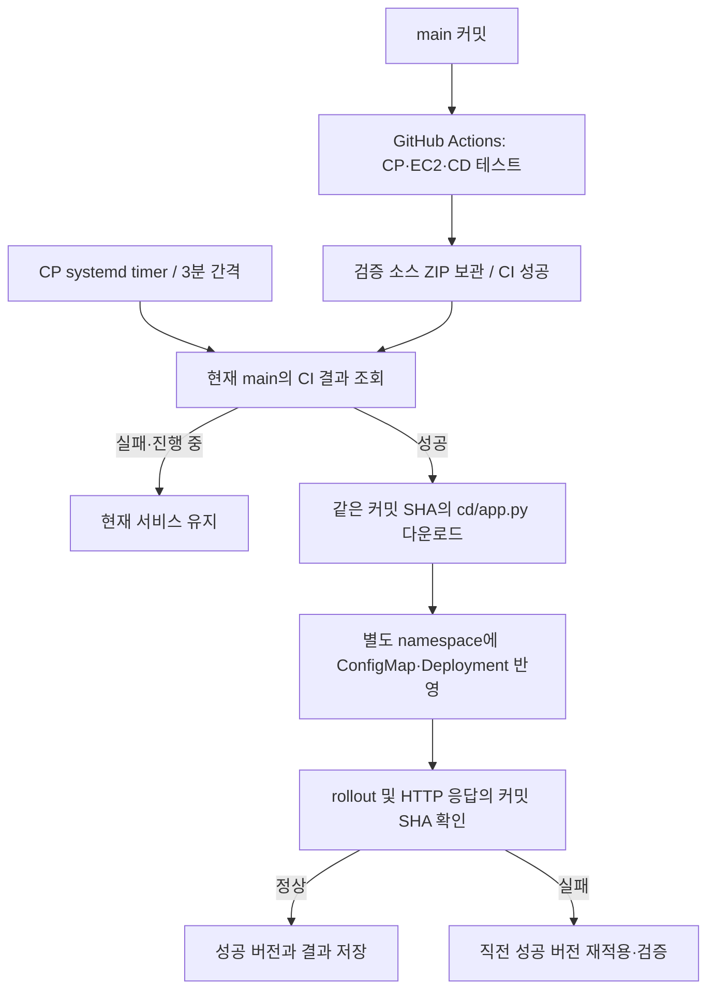

# BEET 테스트 앱 CD

기존 CI 다음에 연결하는 **별도 테스트 앱의 자동 배포**다. Nextcloud, Redis, 운영 분석기,
OpenStack 워커 자동화의 운영 코드를 배포하는 기능과 구분한다.

## 흐름



## CI와 CD의 경계

- CI: GitHub 호스팅 Ubuntu에서 CP 20개·EC2 19개·CD 10개 테스트를 실행한다.
- CD: CP에 설치한 `pull_deploy.py`가 GitHub API를 조회해 현재 main의 CI 성공을 확인한다.
- 배포 소스는 임의의 최신 파일이 아니라 **CI가 통과한 커밋 SHA**로 내려받는다.
- CI가 보관하는 ZIP은 증빙용이다. 이 CD는 ZIP을 다운로드하지 않고 같은 SHA의 소스를 가져온다.
- 기존 Python 런타임 이미지 위에 소스를 ConfigMap으로 마운트한다. 자체 이미지 빌드·레지스트리
  푸시는 이번 범위에 포함하지 않는다.
- 배포 후 Deployment rollout과 `/healthz`의 HTTP 200·release SHA를 확인한다.
- main에 push하면 사람의 별도 배포 명령 없이 반영되므로 테스트 환경의 Continuous Deployment다.

## 이 방식을 선택한 이유

CP는 외부 GitHub에 HTTPS로 접속한다. GitHub runner가 사설 CP로 들어오거나 배포 SSH 키를
보관할 필요가 없다. 공개 저장소의 PR 코드를 CP에서 테스트·실행하는 self-hosted runner도 설치하지 않는다.
CP의 배포기는 자동으로 자기 자신을 업데이트하지 않는다. 배포기와 systemd 설정 변경은 검토 후 별도 적용한다.

대신 웹훅처럼 즉시 실행되지 않고 최대 약 3분의 조회 대기 시간이 생긴다. API 제한·네트워크 오류 시
기존 버전을 유지하고 다음 주기에 다시 확인한다. 공개 API의 비인증 호출 한도를 고려해 주기를 설정했다.
동일 공인 IP의 다른 GitHub API 사용량에 따라 제한에 걸릴 수 있다.

## 대상과 파일

| 파일/대상 | 역할 |
|---|---|
| `.github/workflows/ci.yml` | 세 구성요소 테스트와 성공 후 패키징 |
| `cd/app.py` | 버전 SHA와 상태를 반환하는 작은 HTTP 앱 |
| `cd/pull_deploy.py` | CI 판정, 지정 SHA 다운로드, 배포·검증·실패 복원 |
| `cd/test_cd.py` | 성공·실패·PR·커밋 판정 및 배포 격리 테스트 |
| `cd/setup.py` | 전용 namespace와 systemd timer 최초 설치 |
| `cd/beet-demo-cd.service`, `.timer` | CP에서 정기 조회 실행 |
| namespace `beet-cd-demo` | 다른 운영 앱과 분리한 배포 공간 |
| Service `beet-cd-demo:8080` | 클러스터 내부 HTTP 연결 |

파드는 w1에 배치하고 CPU 10m/RAM 24Mi를 요청한다. 상한은 CPU 200m/RAM 64Mi다.
비루트 실행, 서비스 계정 토큰 미마운트, 읽기 전용 루트 파일 시스템, egress 차단을 적용한다.
CP 배포기는 기존 ubuntu 계정의 sudo kubectl 권한을 사용한다. namespace 전용 RBAC로 제한된
실행 계정은 이번 구현에 포함하지 않았으며, 운영 확장 전 보완 대상이다.

## CP에서 확인

```bash
sudo systemctl status beet-demo-cd.timer --no-pager
sudo journalctl -u beet-demo-cd.service -n 60 --no-pager
sudo -n k3s kubectl -n beet-cd-demo get pods,service -o wide
cat /home/ubuntu/beet-demo-cd/state.json
```

HTTP 응답:

```bash
VIP=$(sudo -n k3s kubectl -n beet-cd-demo get service beet-cd-demo -o jsonpath='{.spec.clusterIP}')
curl -fsS "http://$VIP:8080/healthz"
```

`release`는 실제 배포된 커밋 SHA다. GitHub Actions는 CI 상태를, CP journal과 state.json은 CD 상태를
보여준다. GitHub에서 CI가 초록색이라는 사실만으로 배포 완료라고 판단하지 않는다.

## 수정과 재배포

GitHub의 `cd/app.py` 메시지를 수정해 main에 커밋한다. CI 성공 후 다음 조회에서 새 파드가 배포되고
HTTP release가 새 커밋으로 바뀌는지 확인한다. PR만 열어서는 배포하지 않는다.
배포 중복은 로컬 파일 잠금으로 막는다. 같은 커밋은 반복 배포하지 않는다.

배포가 실패하면 직전 성공 manifest를 재적용하고 해당 버전의 응답을 확인한다.
최초 배포에는 이전 버전이 없으므로 실패한 Deployment를 제거한다. 실패 커밋은 `failed.json`에 기록해
자동 반복 배포를 막는다. 새 수정 커밋을 올리거나 원인을 해결한 뒤 CP에서 그 파일을 이름 변경해 재시도한다.
복원 자체가 실패할 수도 있으며 이 경우 journal의 오류를 확인해 수동 조치해야 한다.

## 설치 및 중지

검토한 `cd/` 파일을 CP의 `/home/ubuntu/beet-demo-cd`에 복사한 뒤:

```bash
cd /home/ubuntu/beet-demo-cd
python3 -m unittest discover -s . -p test_cd.py -v
python3 setup.py
sudo systemctl start beet-demo-cd.service
```

자동 배포 중지(현재 앱 유지):

```bash
sudo systemctl disable --now beet-demo-cd.timer
```

## 범위와 한계

이것은 학습용 앱의 실제 CD이며 BEET 운영 코드 전체 CD 완료를 의미하지 않는다.
GitHub main 쓰기 권한이 배포 권한과 연결된다. 현재 branch protection은 설정하지 않았으므로
운영 적용 전 PR 승인·보호 규칙을 추가해야 한다. 런타임 이미지는 `python:3.12-alpine` 태그를 쓰며
digest 고정·서명 검증·공급망 검사는 후속 개선이다. 소스 ConfigMap과 이전 ReplicaSet은 장기 운영 시
보존 수를 정해 정리해야 한다. CP 자체 장애 시 배포 조회도 중단되지만 기존 파드 실행과는 별개다.

## 참고

[GitHub Actions 보안](https://docs.github.com/en/actions/reference/security/secure-use)
· [Kubernetes 롤링 업데이트](https://kubernetes.io/docs/tasks/run-application/update-deployment-rolling/)
