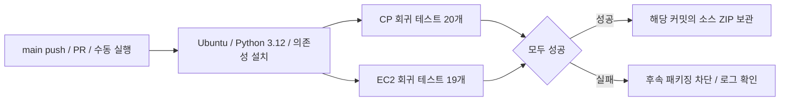

# GitHub Actions 기반 CI

## 구성 목적

인프라 확장 자동화 코드를 수정할 때 기존 정책·실행 경계가 깨졌는지 자동으로 확인하기 위해 추가했다. 기존 프로젝트의 운영 자동화와 별개로, GitHub에 코드를 push하거나 PR을 열면 회귀 테스트를 수행하는 개발 검증 흐름이다.

## 실행 흐름

설정 파일: [ci.yml](../.github/workflows/ci.yml)

| 구성 | 동작 |
|---|---|
| 시작 조건 | main push, main 대상 pull_request, workflow_dispatch |
| 실행 환경 | GitHub 호스팅 Ubuntu / Python 3.12 |
| CP 테스트 | `python -X utf8 -m unittest discover -s cp -p 'test_*.py' -v` |
| EC2 테스트 | `python -X utf8 -m unittest discover -s ec2/analyzer -p 'test_*.py' -v` |
| 오류 전파 | `tee`로 로그를 남겨도 `pipefail`로 테스트 실패 코드를 유지 |
| 패키징 조건 | `needs: tests`로 두 테스트 작업이 모두 성공해야 실행 |
| 보관 결과 | 테스트 로그와 검증한 커밋의 소스 ZIP, 14일 보관 |
| 권한 | contents: read, checkout 인증 정보 미보존 |
| 도구 고정 | GitHub 공식 Actions를 전체 커밋 SHA로 고정 |

## 통제된 실패 시험

수동 실행 입력 `failure_probe=true`는 회귀 테스트 후 CP 작업에 의도적인 `exit 1`을 발생시킨다. 이때 전체 실행이 실패하고 `Package verified source` 작업이 건너뛰어지는지 확인한다. 정상 테스트의 결함을 발견했다고 주장하는 기록이 아니라, CI 실패 전파와 후속 단계 차단을 확인하는 교육용 시험이다. push·PR 실행과 기본 수동 실행에서는 꺼져 있다.

실패 시험 후 `failure_probe=false`로 다시 실행하여 정상 테스트와 소스 패키징을 확인한다. 일반 테스트가 실패하면 Actions에서 실패한 작업과 단계를 열어 로그를 확인하고 코드를 수정한 후 다시 push한다.

## 검증 범위

2026-11-21 실제 GitHub Actions 실행 기록:

| 실행 | 입력/계기 | 관찰 결과 |
|---|---|---|
| [첫 CI 실행 #1](https://github.com/Kimjunbaek/beet-openstack-autoscaling/actions/runs/44888549942) | 워크플로 추가 push | CP 20개·EC2 19개 통과, 검증 소스 패키징 성공 |
| [실패 차단 시험 #2](https://github.com/Kimjunbaek/beet-openstack-autoscaling/actions/runs/44888675628) | 수동 `failure_probe=true` | 회귀 테스트는 통과, 지정한 실패 단계만 exit 1, 패키징 skipped |
| [정상 재실행 #3](https://github.com/Kimjunbaek/beet-openstack-autoscaling/actions/runs/44888743929) | 수동 `failure_probe=false` | CP·EC2 회귀 테스트와 검증 소스 패키징 모두 성공 |

첫 실행 로그의 unittest 결과는 CP `Ran 20 tests`, EC2 `Ran 19 tests`였다. 초기 정상 실행의 전체 소요 시간은 44초, 통제된 실패 시험은 22초로 표시됐다. 단일 CI 실행 시간이며 인프라 확장 시간과는 관계없다.

CP는 실제 Linux `fcntl` 모듈을 import하지만, 이 회귀 테스트 자체가 프로세스 간 잠금 경합을 시험하는 것은 아니다. OpenStack 자원·SSH·명령 실행에는 기존 테스트의 모의 객체를 사용한다. 실제 VM 생성, K3s 조인, Octavia 반영, 운영 서버 배포가 이 CI에서 수행되는 것은 아니다.

이 구현의 정확한 명칭은 **자동 테스트와 검증 소스 패키징을 포함한 CI**다. 실제 환경에 코드를 배포하고 상태를 확인하는 CD는 아직 연결하지 않았다. 소스 ZIP 보관을 운영 배포 성공으로 표현하지 않는다.

## 면접 설명

“기존 OpenStack 워커 자동화 코드에 GitHub Actions 기반 CI를 추가했습니다. main push와 PR에서 CP·EC2 회귀 테스트가 자동 실행되고, 모두 통과한 커밋만 소스 아티팩트로 보관되도록 구성했습니다. 의도적인 실패 입력으로 후속 패키징 차단을 검증했습니다. 실제 인프라 배포를 수행하는 CD와는 구분합니다.”

AI 도구의 도움으로 설정·검증을 진행했다. 직접 설명할 때는 트리거, Linux runner, 테스트 실패 전파, `needs` 의존 관계, CI와 CD의 차이를 확인하고 사용한다.

## 참고

[Python 자동 테스트 공식 문서](https://docs.github.com/en/actions/tutorials/build-and-test-code/python) · [공식 아티팩트 문서](https://docs.github.com/en/actions/tutorials/store-and-share-data)
